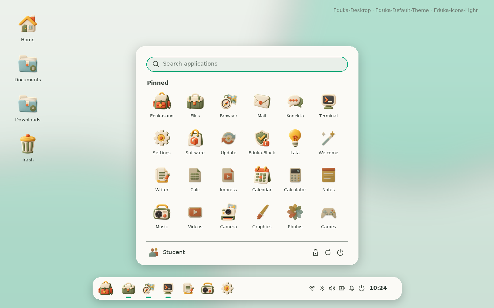
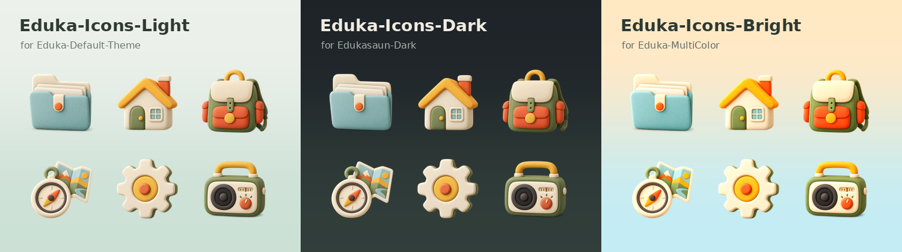
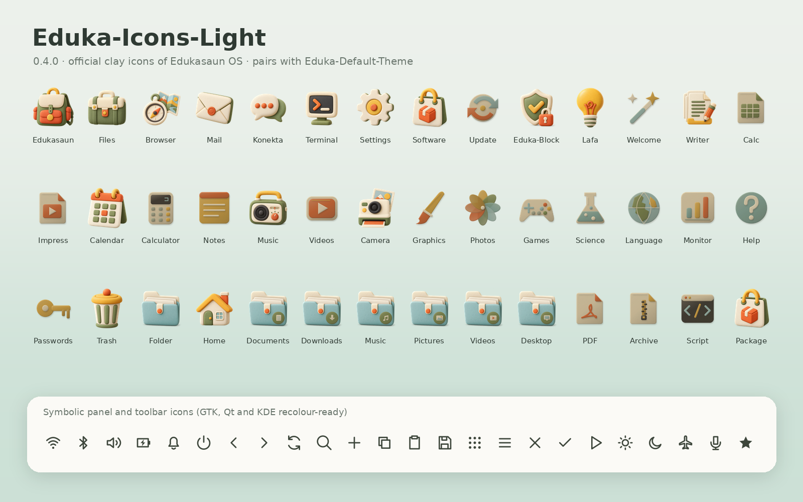
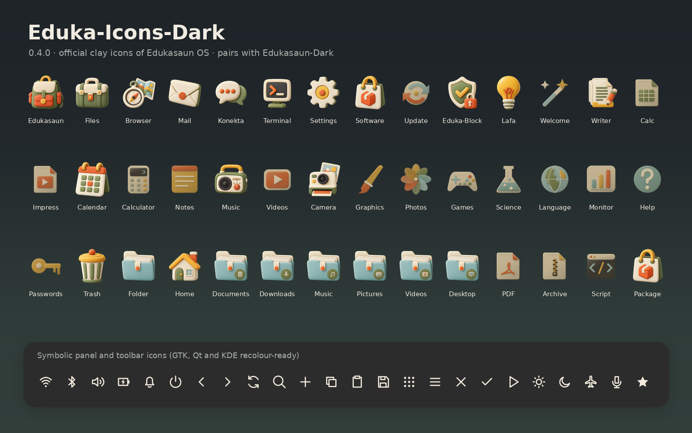
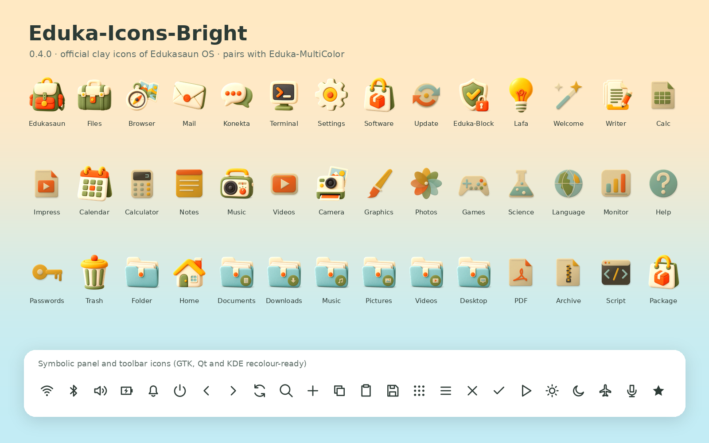
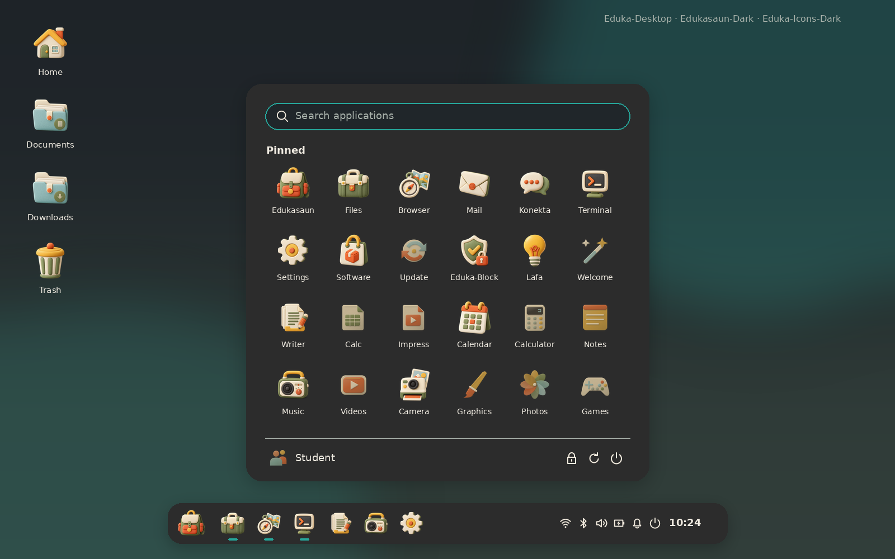
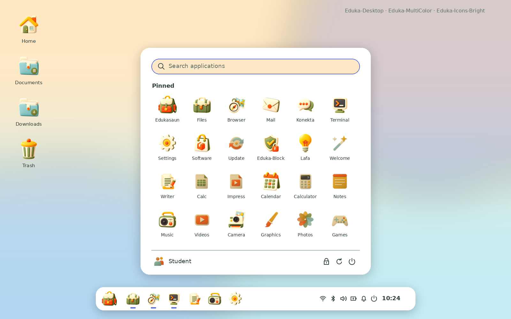
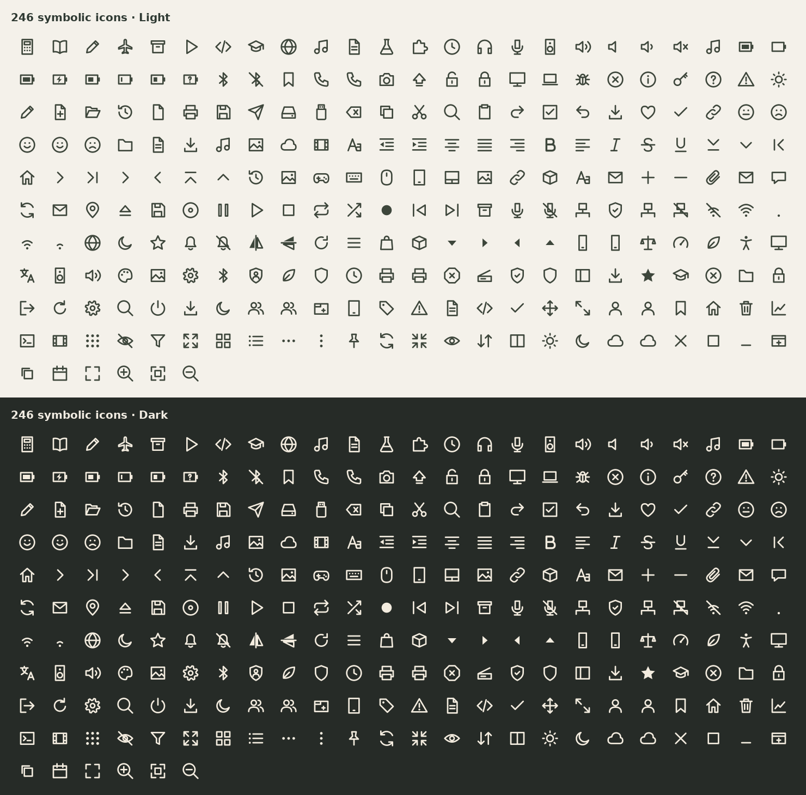

# Eduka-Icons

Official icon themes of **Edukasaun OS**: soft, matte, hand-sculpted clay
artwork in cream, burnt orange, golden yellow, olive and dusty aqua. Built for
[Eduka-Desktop](https://github.com/hugomonizdorego/Eduka-Desktop) and usable
on every Linux desktop environment and window manager.



| Theme | Use it with | Symbolic icons |
| --- | --- | --- |
| **Eduka-Icons-Light** (default) | Eduka-Default-Theme, Liquid Glass, Eduka-Low-Theme, any light theme | dark grey |
| **Eduka-Icons-Dark** | Edukasaun-Dark, Eduka-Transparan, any dark theme | warm white |
| **Eduka-Icons-Bright** | Eduka-MultiColor, colourful or very bright themes | deep slate |



Bright keeps the same shapes with livelier, more saturated clay colours. It is
the recommended choice for school labs, children's accounts and colourful
wallpapers.

## What is inside

- **88 clay artworks** used by **1,100+ icon names**: Eduka applications
  (Eduka-Desktop, Eduka-Settings, Eduka-Konekta, Eduka-Block, Lafa, Update
  System, Welcome), settings pages, places and folders, devices, file types and
  the default applications of LXQt, Xfce, GNOME, KDE, MATE, Cinnamon and LXDE.
- **246 symbolic glyphs / 520+ symbolic names** for panels, toolbars, menus and
  dialogs. They are filled outlines, so GTK 3/4 recolouring, Qt and KDE all
  render them cleanly.
- HiDPI: 16–512 px plus `@2x` directories with `Scale=2`.
- Fallback chain for anything not drawn yet: Papirus → Breeze → Adwaita →
  hicolor (missing themes are skipped automatically).
- `eduka-icons-select`: selects the theme for every desktop, sets system
  defaults for an ISO, and follows the Eduka-Desktop theme (dark themes switch
  to Dark, Eduka-MultiColor to Bright).

Coverage is checked on every build (`make test`):

| Icon list | Eduka artwork |
| --- | --- |
| Every icon name Eduka-Desktop 0.9.24 requests | 158 / 158 |
| freedesktop.org Icon Naming Specification | 285 / 285 |
| Default apps of Debian desktops (reference list) | 114 / 114 |

## Install (.deb)

The ready-made package is in [`release/eduka-icons_0.4.0_all.deb`](release/eduka-icons_0.4.0_all.deb)
(also built by GitHub Actions on every push and attached to `v*` releases).

```sh
sudo apt install ./eduka-icons_0.4.0_all.deb
```

On first installation Eduka-Icons-Light becomes the default icon theme for new
accounts and the live session. Pick another variant at any time:

```sh
eduka-icons-select --apply Dark          # this account, every desktop
eduka-icons-select --follow-desktop      # follow the Eduka-Desktop theme again
eduka-icons-select --status
```

### Cubic (Edukasaun OS ISO)

Copy the `.deb` into the Cubic terminal (drag and drop), then:

```sh
apt update
apt install -y ./eduka-icons_0.4.0_all.deb
# Dark or Bright as the ISO default instead:
# EDUKA_ICONS_DEFAULT=Bright apt install -y ./eduka-icons_0.4.0_all.deb
rm ./eduka-icons_0.4.0_all.deb
```

Full guide, per-desktop details and troubleshooting: [docs/INSTALL.md](docs/INSTALL.md).

## Build from source

Debian 13 / Edukasaun OS:

```sh
sudo apt install python3 python3-pil librsvg2-2 librsvg2-common libcairo2 libgtk-3-0 \
     gtk-update-icon-cache dpkg make fonts-dejavu-core
make build          # build/themes/Eduka-Icons-{Light,Dark,Bright}
make test           # source check, validation, GTK lookups, coverage report
make screenshots    # docs/screenshots/*.png
make deb            # dist/eduka-icons_<version>_all.deb
make install        # copy to ~/.local/share/icons and select Light (no sudo)
```

The build is offline and reproducible from the files in this repository.

| Path | Purpose |
| --- | --- |
| `assets/masters/` | 17 hero clay masters (lossless WebP, checksummed) |
| `tools/artwork.py` | clay compositions and the icon-name catalog |
| `tools/symbolic.py`, `tools/outline.py` | symbolic glyphs and stroke-to-fill conversion |
| `tools/build_theme.py` | builds the three themes |
| `tools/select_theme.py` | `eduka-icons-select` (user, system, follow mode) |
| `tools/build_deb.py` | Debian package |
| `tools/validate.py`, `tools/check_lookup.py`, `tools/coverage.py` | tests |
| `tools/preview.py` | screenshots |

## Screenshots

| Light | Dark | Bright |
| --- | --- | --- |
|  |  |  |
|  |  |  |



## Credits and licence

Artwork and code: Hugo Moniz do Rego and the Edukasaun OS project, GPL-3.0
(see `LICENSE`). Eduka-Icons started as a fork of the
[Papirus icon theme](https://github.com/PapirusDevelopmentTeam/papirus-icon-theme)
(GPL-3.0); the clay artwork is original and Papirus remains the recommended
fallback for applications Eduka has not drawn yet.
