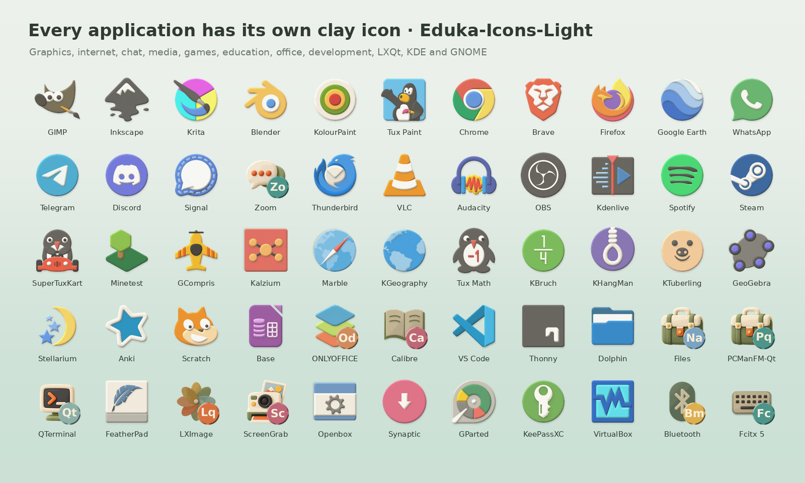
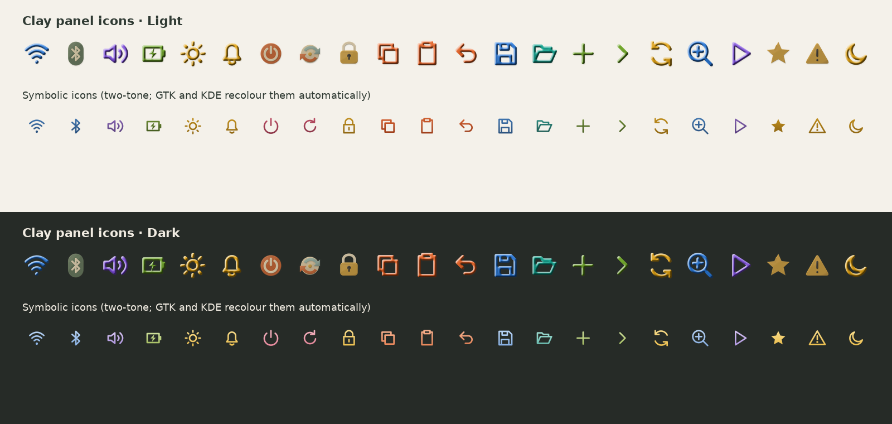
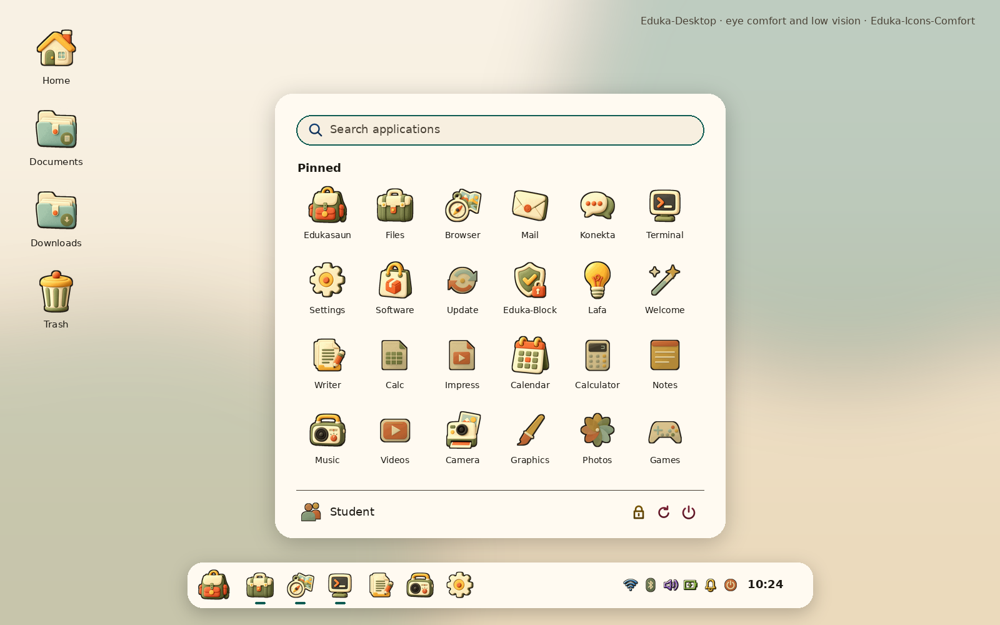
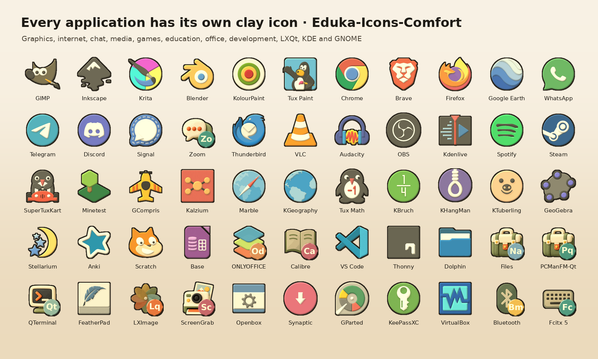

# Eduka-Icons

Official icon themes of **Edukasaun OS**: soft, matte, hand-sculpted clay
artwork in cream, burnt orange, golden yellow, olive and dusty aqua. Built for
[Eduka-Desktop](https://github.com/hugomonizdorego/Eduka-Desktop) and usable
on every Linux desktop environment and window manager.


| Theme | Use it with |
| --- | --- |
| **Eduka-Icons-Light** (default) | Eduka-Default-Theme, Liquid Glass, Eduka-Low-Theme, any light theme |
| **Eduka-Icons-Dark** | Edukasaun-Dark, Eduka-Transparan, any dark theme |
| **Eduka-Icons-Bright** | Eduka-MultiColor, colourful or very bright themes, school labs, children |
| **Eduka-Icons-Comfort** | eye comfort and low vision: dark contours, warm low-blue colours, high contrast |


## Every application has its own icon



- **Eduka hero artwork** for the desktop itself: Eduka applications, folders,
  places, devices, file types, settings and categories.
- **3,700+ application artworks / 8,300+ application names** in clay: GIMP,
  Inkscape, Krita, Chrome, Brave, Firefox, Google Earth, WhatsApp, Telegram,
  Discord, VLC, Steam, LibreOffice, the KDE (apps.kde.org), GNOME
  (apps.gnome.org) and LXQt applications, education, games, office, audio and
  video. They come from the Papirus catalog (GPL-3.0), sculpted into clay at
  build time, so each app keeps a recognisable logo.
- **Monogram chips** keep apps apart that would otherwise share one picture
  (e.g. several programs whose upstream icon is the generic terminal).
- **Applications installed later** get a clay icon automatically:
  `eduka-icons-clayify` converts their own icon after every apt/dpkg run and
  when Flatpak or Snap applications change.

## Colourful clay panel icons



Wi-Fi, Bluetooth, volume, battery, brightness, notifications, power and
toolbar actions are colourful 3D clay. The `-symbolic` icons are two-tone
colour filled outlines, so GTK 3/4 and KDE can still recolour them for their
headerbars, and Qt panels such as Eduka-Panel show the colours.

## Install (.deb)

Packages are in [`release/`](release/) (also built by GitHub Actions on every
push and attached to `v*` releases):

| Package | Content |
| --- | --- |
| `eduka-icons_0.5.0_all.deb` | the four themes and the tools |
| `eduka-icons-apps_0.5.0_all.deb` | application icons (required) |
| `eduka-icons-apps-comfort_0.5.0_all.deb` | application icons, Comfort edition (recommended) |

```sh
sudo apt install ./eduka-icons_0.5.0_all.deb ./eduka-icons-apps_0.5.0_all.deb \
                 ./eduka-icons-apps-comfort_0.5.0_all.deb
```

On first installation Eduka-Icons-Light becomes the default icon theme for new
accounts and the live session. Pick another variant at any time:

```sh
eduka-icons-select --apply Comfort       # this account, every desktop
eduka-icons-select --follow-desktop      # follow the Eduka-Desktop theme again
eduka-icons-select --status
```

### Cubic (Edukasaun OS ISO)

Copy the three `.deb` files into the Cubic terminal (drag and drop), then:

```sh
apt update
apt install -y ./eduka-icons_0.5.0_all.deb ./eduka-icons-apps_0.5.0_all.deb \
               ./eduka-icons-apps-comfort_0.5.0_all.deb
# another ISO default: EDUKA_ICONS_DEFAULT=Bright apt install -y ./eduka-icons*_0.5.0_all.deb
rm ./eduka-icons*_0.5.0_all.deb
```

Full guide, per-desktop details and troubleshooting: [docs/INSTALL.md](docs/INSTALL.md).

## Build from source

Debian 13 / Edukasaun OS:

```sh
sudo apt install python3 python3-pil librsvg2-2 librsvg2-common libcairo2 libgtk-3-0 \
     gtk-update-icon-cache dpkg make fonts-dejavu-core
make build          # build/themes/Eduka-Icons-{Light,Dark,Bright,Comfort,Apps,Apps-Comfort}
make test           # source check, validation, GTK lookups, coverage report
make screenshots    # docs/screenshots/*.png
make deb            # dist/*.deb
make install        # copy to ~/.local/share/icons and select Light (no sudo)
```

The build is offline and reproducible from the files in this repository
(about 15 minutes on 4 cores; app masters are cached in `build/app-masters`).

| Path | Purpose |
| --- | --- |
| `assets/masters/` | 17 hero clay masters (lossless WebP, checksummed) |
| `assets/upstream/` | pinned Papirus application SVGs and their licence |
| `tools/artwork.py`, `tools/clay.py` | Eduka clay compositions and the icon-name catalog |
| `tools/catalog.py` | decides Eduka art, clay app art or a monogram copy for every name |
| `tools/clayify.py` | clay conversion, Comfort edition, monogram chips |
| `tools/symbolic.py`, `tools/outline.py` | symbolic glyphs and stroke-to-fill conversion |
| `tools/build_theme.py`, `tools/build_apps.py` | build the themes |
| `tools/select_theme.py` | `eduka-icons-select` (user, system, follow mode) |
| `tools/clayify_installed.py` | `eduka-icons-clayify` (applications installed later) |
| `tools/build_deb.py` | Debian packages |
| `tools/validate.py`, `tools/check_lookup.py`, `tools/coverage.py` | tests |
| `tools/preview.py` | screenshots |

## Screenshots

| Light | Dark |
| --- | --- |
|  |  |
| **Bright** | **Comfort** |
|  |  |




## Credits and licence

Artwork and code: Hugo Moniz do Rego and the Edukasaun OS project, GPL-3.0
(see `LICENSE`). Eduka-Icons is a fork of the
[Papirus icon theme](https://github.com/PapirusDevelopmentTeam/papirus-icon-theme)
(GPL-3.0, Papirus Development Team): its application artwork is the source of
the clay application icons (`assets/upstream/PAPIRUS-LICENSE`).
