# Eduka-Icons

Official icon themes of **Edukasaun OS**: soft, matte, hand-sculpted clay
artwork in cream, burnt orange, golden yellow, olive and dusty aqua. Built for
[Eduka-Desktop](https://github.com/hugomonizdorego/Eduka-Desktop) and usable
on every Linux desktop environment and window manager.

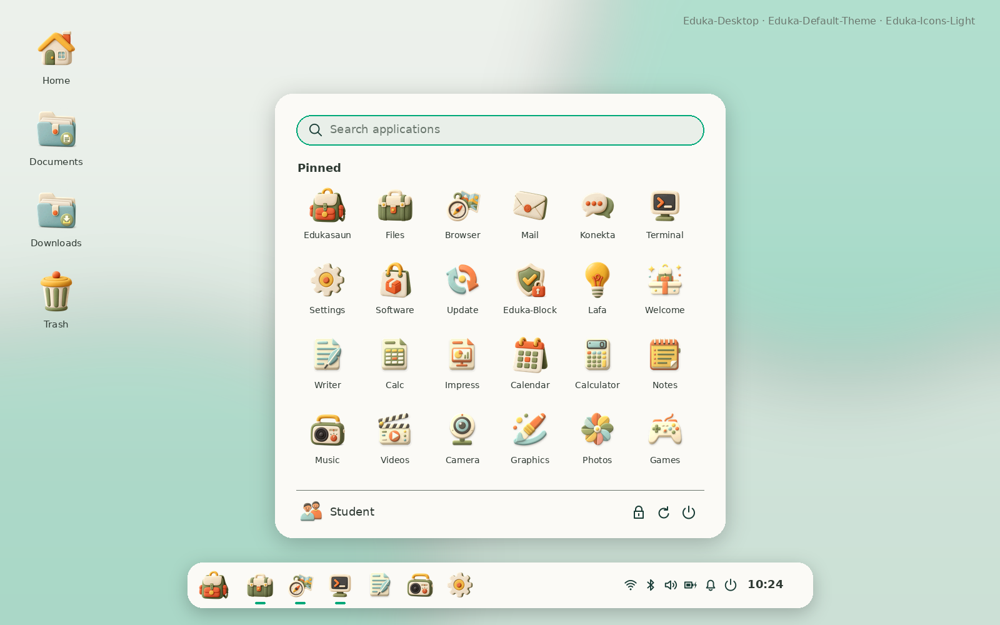

| Theme | Use it with |
| --- | --- |
| **Eduka-Icons-Light** (default) | Eduka-Default-Theme, Liquid Glass, Eduka-Low-Theme, any light theme |
| **Eduka-Icons-Dark** | Edukasaun-Dark, Eduka-Transparan, any dark theme |
| **Eduka-Icons-Bright** | Eduka-MultiColor, colourful or very bright themes, school labs, children |
| **Eduka-Icons-Comfort** | eye comfort and low vision: dark contours, warm low-blue colours, high contrast |

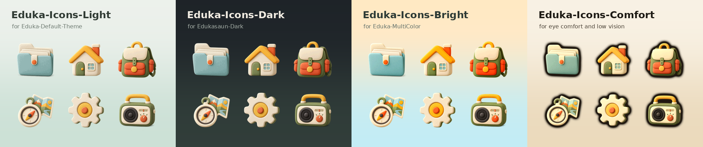

## Detailed clay artwork

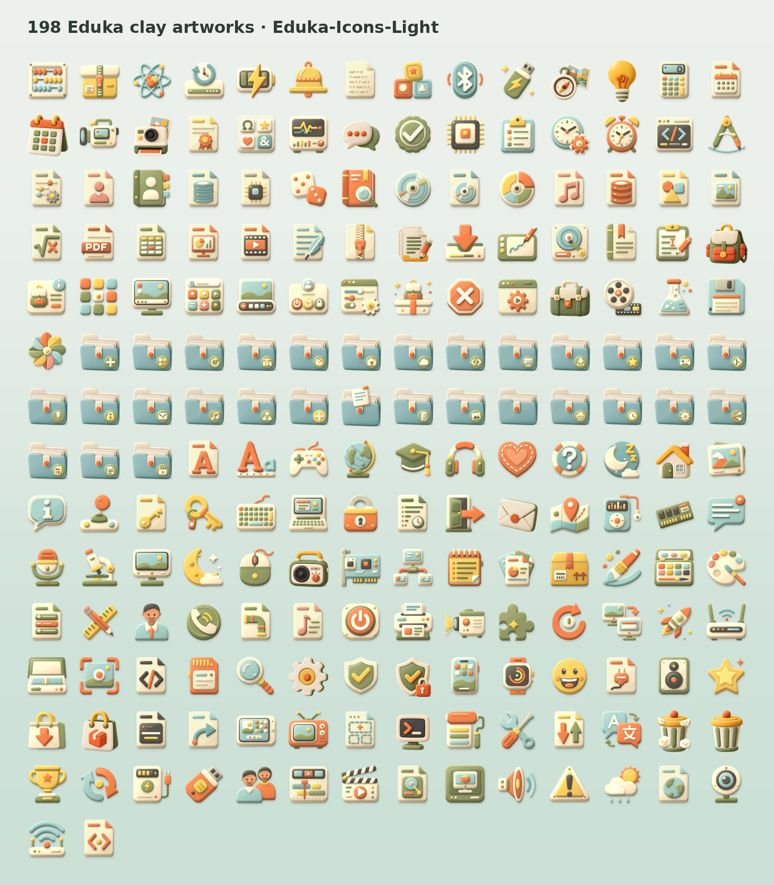

About 150 hand-composed clay pictures for the desktop itself: the
Eduka-Desktop suite, folders, places, devices, file types, settings, dialogs
and learning subjects. Each one is reviewed at 16 to 64 px on light and dark
backgrounds.

## Normal flat tray and toolbar icons

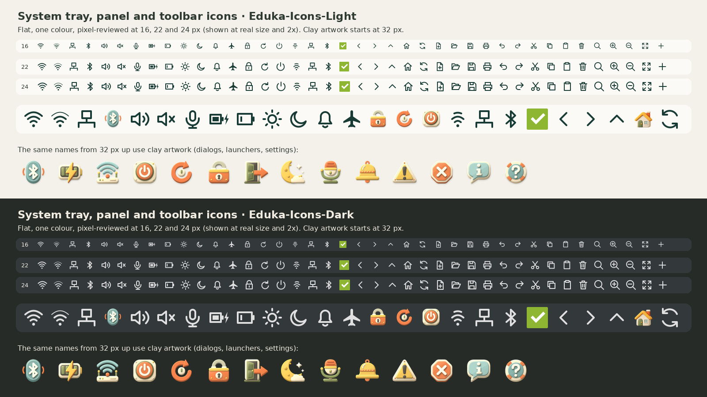

System-tray, panel, toolbar and `-symbolic` icons are flat one-colour line
glyphs in the Eduka-Panel text colour, like the icons of any modern desktop;
clay starts at 32 px. Every state has its own drawing (battery charging per
level, four Wi-Fi levels, airplane mode on/off, presence, weather ...), and
the complete flat set of actions, status, emblem, emote and animation names
(about 14,000) is included for GTK, Qt, KDE and Xfce applications.

## Every application, file type and device has its own icon

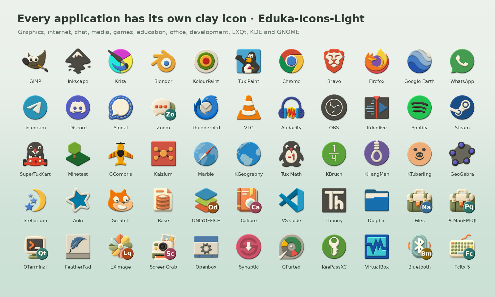
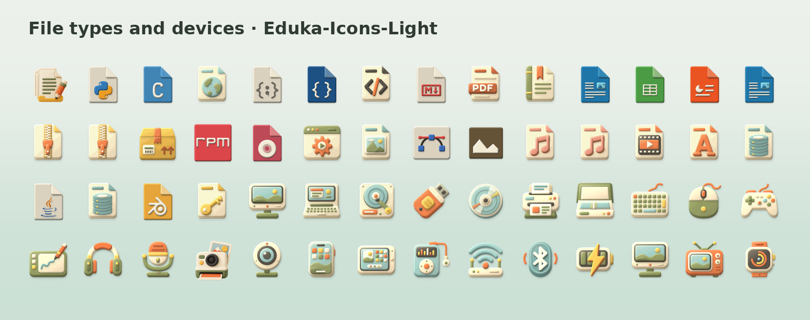

- **3,900+ application artworks / 8,300+ application names** in clay: GIMP,
  Inkscape, Krita, Chrome, Brave, Firefox, Google Earth, WhatsApp, Telegram,
  Discord, VLC, Steam, LibreOffice, the KDE (apps.kde.org), GNOME
  (apps.gnome.org) and LXQt applications, education, games, office, audio and
  video. They come from the Papirus catalog (GPL-3.0), sculpted into clay at
  build time, so each app keeps a recognisable logo.
- **660+ file-type names** and all device names in the same clay style.
- **Monogram chips** keep apps apart that would otherwise share one picture.
- **Applications installed later** get a clay icon automatically:
  `eduka-icons-clayify` converts their own icon after every apt/dpkg run and
  when Flatpak or Snap applications change.

## Folder colours

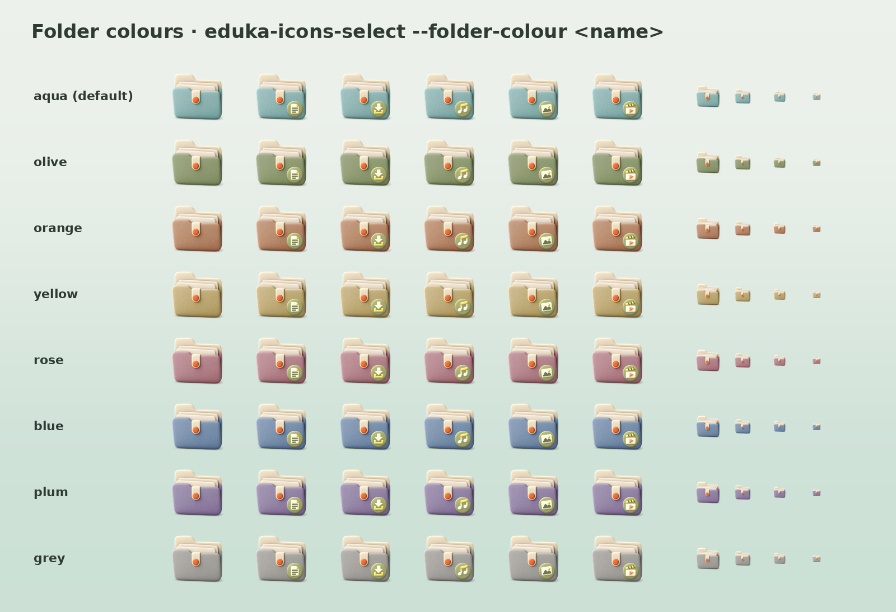

```sh
eduka-icons-select --folder-colour olive     # aqua, olive, orange, yellow, rose, blue, plum, grey
```

## Sizes

Standard freedesktop sizes 16, 22, 24, 32, 48, 64, 96, 128 and 256 px
with HiDPI (@2x) directories; any size in between is scaled down from the
next larger artwork. Sizes, glyph style and colours, folder colours and the
Bright/Comfort tuning are set in [`eduka-icons.toml`](eduka-icons.toml).

## Install (.deb)

Packages are in [`release/`](release/) (also built by GitHub Actions on every
push and attached to `v*` releases):

| Package | Content |
| --- | --- |
| `eduka-icons_1.0.0_all.deb` | the four themes and the tools |
| `eduka-icons-apps_1.0.0_all.deb` | application icons (required) |
| `eduka-icons-apps-comfort_1.0.0_all.deb` | application icons, Comfort edition (recommended) |

```sh
sudo apt install ./eduka-icons_1.0.0_all.deb ./eduka-icons-apps_1.0.0_all.deb \
                 ./eduka-icons-apps-comfort_1.0.0_all.deb
```

On first installation Eduka-Icons-Light becomes the default icon theme for new
accounts and the live session. Pick another variant at any time:

```sh
eduka-icons-select --apply Comfort       # this account, every desktop
eduka-icons-select --follow-desktop      # follow the Eduka-Desktop theme again
eduka-icons-select --status
```

### Cubic (Edukasaun OS ISO)

Copy the three `.deb` files into the Cubic terminal (drag and drop), then:

```sh
apt update
apt install -y ./eduka-icons_1.0.0_all.deb ./eduka-icons-apps_1.0.0_all.deb \
               ./eduka-icons-apps-comfort_1.0.0_all.deb
# another ISO default: EDUKA_ICONS_DEFAULT=Bright apt install -y ./eduka-icons*_1.0.0_all.deb
rm ./eduka-icons*_1.0.0_all.deb
```

Full guide, per-desktop details and troubleshooting: [docs/INSTALL.md](docs/INSTALL.md).

## Build from source

Debian 13 / Edukasaun OS:

```sh
sudo apt install python3 python3-pil librsvg2-2 librsvg2-common libcairo2 libgtk-3-0 \
     gtk-update-icon-cache dpkg make fonts-dejavu-core
make build          # build/themes/Eduka-Icons-{Light,Dark,Bright,Comfort,Apps,Apps-Comfort}
make test           # unit tests, source check, validation, GTK lookups, coverage report
make screenshots    # docs/screenshots/*.png
make deb            # dist/*.deb
make install        # copy to ~/.local/share/icons and select Light (no sudo)
```

The build is offline and reproducible from the files in this repository
(about 45 minutes on 4 cores; app masters are cached in `build/app-masters`).

| Path | Purpose |
| --- | --- |
| `eduka-icons.toml`, `tools/settings.py` | build configuration |
| `tools/art/` | the Eduka clay compositions (one module per group) |
| `tools/artwork.py`, `tools/clay.py` | icon-name catalog and the clay shader |
| `assets/upstream/` | pinned Papirus application, file-type and flat SVGs and their licence |
| `tools/catalog.py`, `tools/contexts.py` | decide the artwork and the context of every name |
| `tools/clayify.py` | clay conversion, Comfort edition, monogram chips |
| `tools/symbolic.py`, `tools/glyph_*.py`, `tools/outline.py` | flat glyphs and stroke-to-fill conversion |
| `tools/flat.py`, `tools/folders.py` | upstream flat set, folder colours |
| `tools/build_theme.py`, `tools/build_apps.py` | build the themes |
| `tools/select_theme.py` | `eduka-icons-select` (user, system, follow mode, folder colours) |
| `tools/clayify_installed.py` | `eduka-icons-clayify` (applications installed later) |
| `tools/build_deb.py` | Debian packages |
| `tools/test_tools.py`, `tools/validate.py`, `tools/check_lookup.py`, `tools/coverage.py` | tests |
| `tools/preview.py`, `tools/art_preview.py`, `tools/glyph_preview.py` | screenshots and review sheets |

## Screenshots

| Light | Dark |
| --- | --- |
|  | 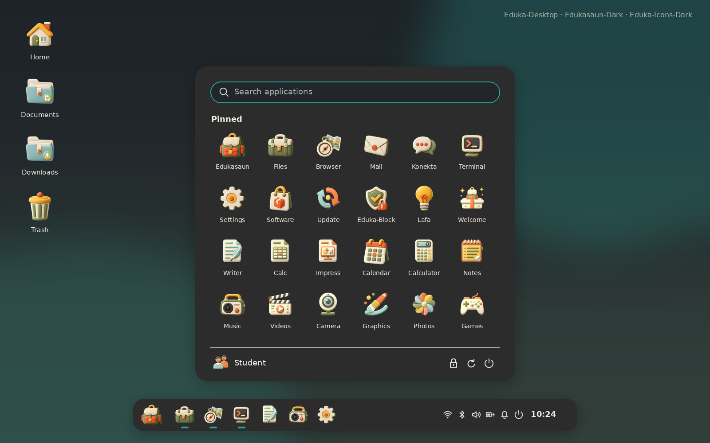 |
| **Bright** | **Comfort** |
| 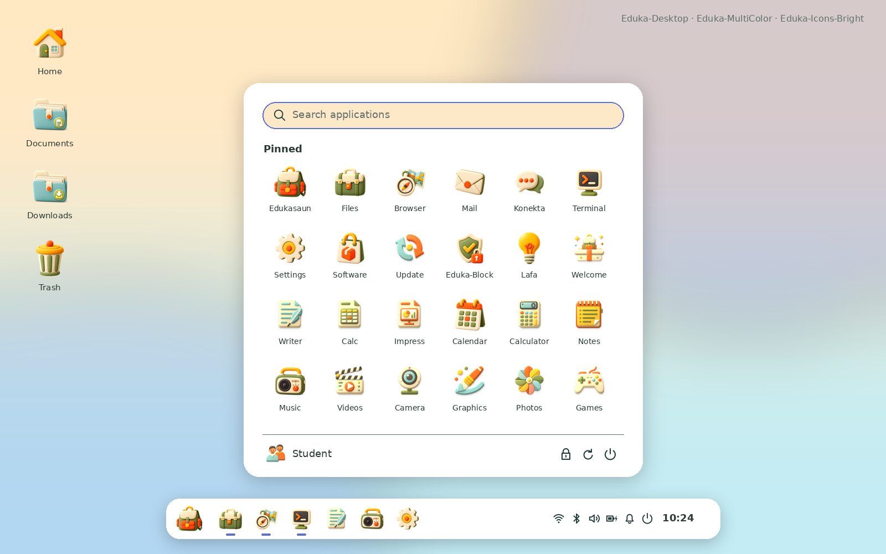 | 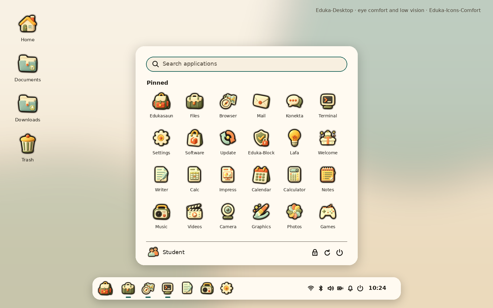 |

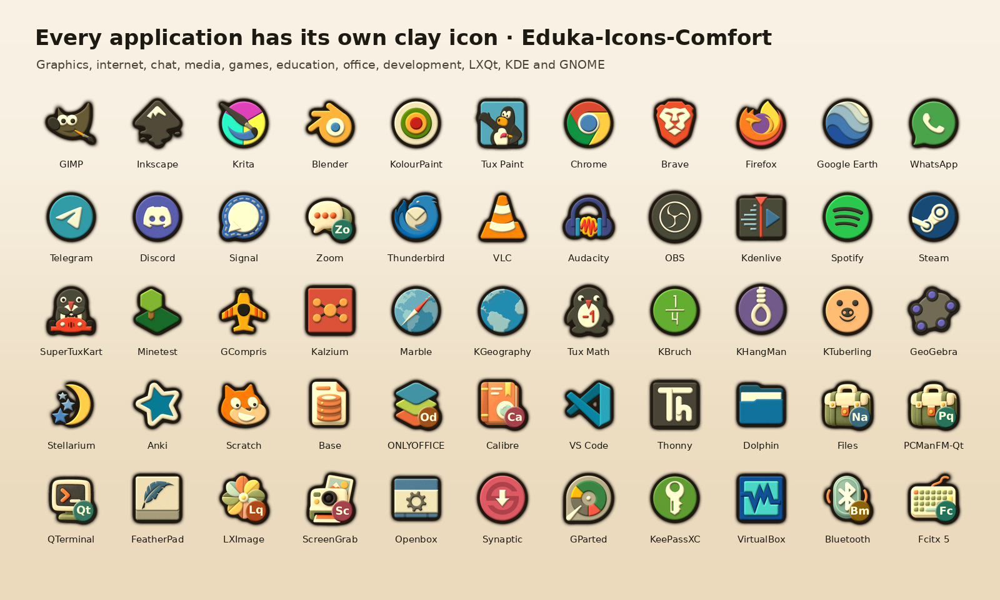
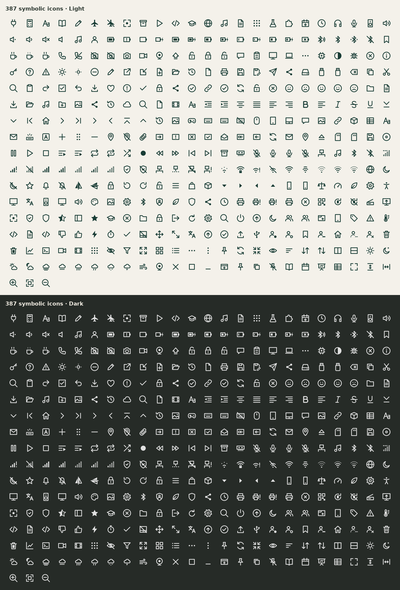

## Credits and licence

Artwork and code: Hugo Moniz do Rego and the Edukasaun OS project, GPL-3.0
(see `LICENSE`). Eduka-Icons is a fork of the
[Papirus icon theme](https://github.com/PapirusDevelopmentTeam/papirus-icon-theme)
(GPL-3.0, Papirus Development Team): its application artwork is the source of
the clay application icons (`assets/upstream/PAPIRUS-LICENSE`).
